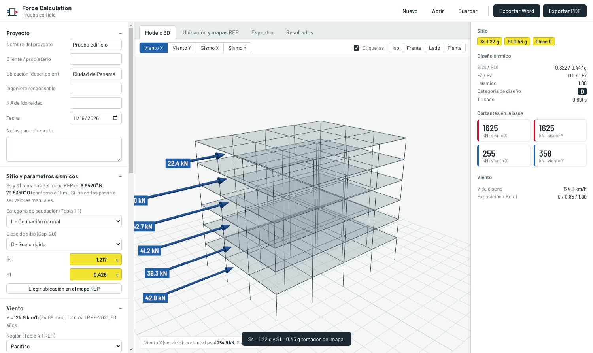
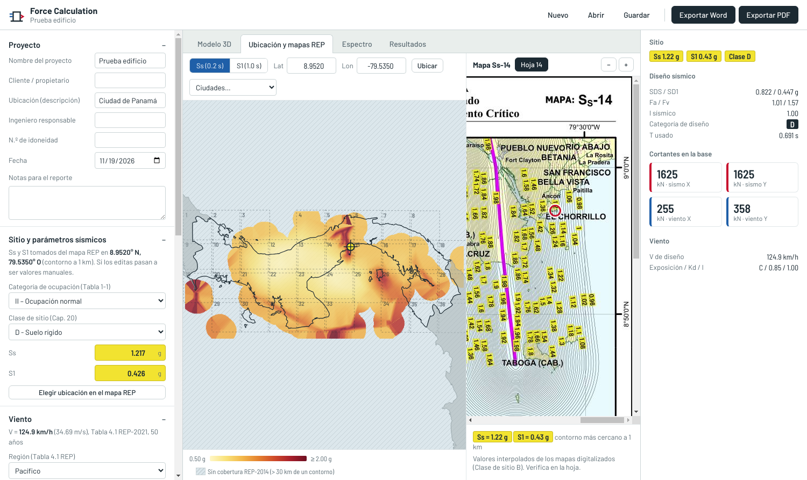

# Force Calculation · REP-2021

Aplicación de escritorio (Electron) para calcular **cargas de viento y sismo** según el
**Reglamento de Diseño Estructural de Panamá REP-2021** (que adopta ASCE/SEI 7-05),
con visor 3D interactivo, selección de Ss/S1 sobre los mapas oficiales y exportación
de la memoria de cálculo a **Word (.docx)** y **PDF**.



## Qué hace

| Tipología | Viento (ASCE 7-05 Cap. 6, Método 2) | Sismo (ASCE 7-05 Cap. 11/12/15) |
|---|---|---|
| Edificio de varios niveles | Fuerzas por nivel en X e Y (barlovento + sotavento), presiones en techo, torsión caso 2, carga mínima 0.48 kPa | FLE por dirección, Ta, Cu, Cs con mínimo REP, distribución vertical, cortantes y momentos |
| Nave industrial a dos aguas | Cp de muros y techo (Fig. 6-6), ±GCpi, casos A/B, cargas lineales por marco | Cortante basal y por marco |
| Torre de celosía / chimenea / poste | Cf de Fig. 6-23 (ε) o Fig. 6-21, factor de ráfaga flexible Gf, accesorios (Cf·A) | No-edificio Tabla 15.4-2, período manual o Rayleigh con EI |
| Tanque cilíndrico o cuadrado (elevado sobre patas, pedestal, o apoyado sin patas) | Recipiente (Fig. 6-21 circular o cuadrada) y soporte; sin patas no hay cargas de patas | Péndulo invertido con masa de agua (Tabla 15.4-2, tanques elevados) o tanque apoyado en el terreno (Tabla 15.4-2, tanques de fondo plano) |
| Valla publicitaria (en terreno o sobre la azotea de una edificación de N niveles) | Anuncio sólido (Fig. 6-20, casos A, B y C con torsión, aberturas y esquina de retorno) o abierto (Fig. 6-22), sobre postes o sin postes (anclada directamente o apoyada como muro) | En terreno: no-edificio (rígida sin postes: V = 0.30·SDS·W·I, §15.4.2) "Signs and billboards" (R = 3.5, Cs ≥ 0.03). En azotea: componente no estructural Cap. 13 (Fp con ap = Rp = 2.5 y 1 + 2z/h) |
| Volumen genérico | Lista de cuerpos configurables (prisma o cilindro, sólido o abierto, a cualquier cota sobre el terreno, con columnas de apoyo; techo plano, a una, dos o cuatro aguas, o domo en cilindros); Cf por franjas (Fig. 6-21/6-23) en X e Y, presiones de techo por Fig. 6-6 y domos por Fig. 6-7 | FLE con cualquier sistema de las Tablas 12.2-1 o 15.4-2 |

Disposiciones propias del REP-2021 incluidas:

- Velocidad básica de viento de la **Tabla 4.1** (Pacífico/Atlántico; 10, 20, 50 y 100 años). Las cargas resultantes son de servicio (§4.2).
- Límites de deformación bajo viento de §4.3: H/400, h/300 y 0.2 m/s².
- **Cs mínimo = 0.044·SDS·I**, con piso de 0.01 en edificios y 0.03 en no-edificios (§5.2.1).
- **TL = 10 s** (§5.13).
- Ss y S1 de los **mapas de aceleraciones espectrales** (§5.12).

## Entorno de exposición en el visor

La casilla **Entorno** dibuja un esquema de la categoría de exposición alrededor de la
estructura (B con edificaciones y arbolado denso, C con terreno abierto y obstáculos
dispersos, D con agua a barlovento) y una flecha que indica la dirección del caso de
carga activo: azul "Viento X / Viento Y" o roja "Sismo X / Sismo Y".

## Topografía en el visor

Con el efecto topográfico activado (Viento → Kzt), el visor dibuja el relieve de la
Fig. 6-4 (cresta 2D, escarpe/acantilado 2D o colina 3D) con H, Lh y la distancia x
a la cresta, coloca la estructura sobre el terreno y muestra Kzt en la base y en la
cima. El botón **Sitio** encuadra todo el relieve. La cresta de un relieve 2D es
perpendicular a la dirección X: Kzt se aplica al viento en X y vale 1 para el viento en Y
(paralelo a la cresta); la colina 3D aplica en ambas direcciones.

## Mapas Ss y S1

Los 72 mapas de `REP-2014 MAPAS.pdf` (hojas 1–36 de Ss y de S1) se digitalizaron
automáticamente (`tools/digitize/`) y se convirtieron en una grilla de 0.01° que la app
interpola por coordenadas. En la pestaña **Ubicación y mapas REP** se hace clic en el
mapa de Panamá y al lado se muestra **la hoja REP original** con el punto marcado. Se
puede afinar la ubicación haciendo clic sobre la misma hoja, que tiene los nombres de
los corregimientos. La pantalla se divide en dos: arriba el mapa de mosaicos y abajo la
hoja REP; en ambos la rueda del ratón hace zoom y arrastrar desplaza la vista.



Precisión, medida con validación cruzada sobre las propias etiquetas de los mapas:

- **Error mediano:** 0.011 g en Ss y 0.009 g en S1.
- **Percentil 90:** 0.09 g en Ss, en zonas de curvas muy apretadas cerca de fallas.

> **Cobertura:** los mapas REP-2014 **no tienen curvas** en el occidente de Chiriquí
> (hojas 1, 2, 9, 10, 20; por ejemplo David y Boquete) ni en algunas zonas del Darién.
> Allí la app no interpola: muestra "sin cobertura" y pide Ss y S1 manuales. El REP-2021
> menciona mapas nuevos "para toda la República" que la JTIA distribuye por separado.
> Si la etiqueta de contorno más cercana está a más de 15 km, la app advierte que la
> confianza es baja.

## Descarga (Windows)

**[ForceCalculation-REP2021-Setup-1.3.1.exe](https://github.com/adrianguerra199510-jpg/FORCE-CALCULATION/raw/claude/nifty-einstein-5vo4up/instalador/ForceCalculation-REP2021-Setup-1.3.1.exe)** (93 MB, Windows 10/11 de 64 bits)

1. Descarga y ejecuta el instalador. Permite elegir la carpeta y crea accesos directos en el escritorio y en el menú Inicio.
2. El instalador no está firmado digitalmente. Windows SmartScreen mostrará "Windows protegió su PC": haz clic en **Más información → Ejecutar de todas formas**.
3. Los proyectos se guardan como `.fcp`; el instalador asocia esa extensión con la app.

SHA-256: `77090e3dfba8eb5f2a8da51544b68afe6bde9793646e4a824922ba2daab76b62`

## Instalación y uso (desde el código)

Requisitos: [Node.js](https://nodejs.org) 20 o superior.

```bash
npm install
```

```bash
npm start
```

Generar el instalador de Windows (desde Windows):

```bash
npm run dist
```

El instalador queda en `dist/ForceCalculation-REP2021-Setup-1.3.1.exe`.

Flujo de trabajo:

1. **Proyecto:** nombre, cliente, ingeniero y fecha (aparecen en la portada del reporte).
2. **Sitio:** en *Ubicación y mapas REP* elige el punto (Ss y S1 se llenan solos); define la clase de sitio y la categoría de ocupación.
3. **Viento:** región, período de retorno, exposición, cerramiento y efecto topográfico opcional.
4. **Estructura:** tipología, geometría, pesos y sistema resistente.
5. Revisa el **Modelo 3D**, el **Espectro** y los **Resultados**.
6. **Vista previa** para revisar el reporte completo dentro de la app y, desde ahí, **Exportar Word** o **Exportar PDF**.

En edificio, nave y volumen genérico, el caso **Envolvente** del visor y la sección 6 del reporte
dan, para cada cara, la presión neta máxima y la succión neta máxima a aplicar (viento ±X, ±Y,
±GCpi y casos A/B), con el caso que gobierna y el área de la cara.

Los proyectos se guardan como archivos `.fcp` (JSON).

## Pruebas

```bash
npm test
```

Las pruebas unitarias verifican los valores contra las tablas de ASCE 7-05 (Fa, Fv, Kz,
G, Cp, Cf, Cs) y contra la Tabla 4.1 del REP. La autoprueba de la interfaz recorre las
4 tipologías, toma capturas y exporta los 8 reportes:

```bash
FC_SELFTEST=/ruta/salida npx electron .
```

## Estructura

```
src/
  calc/        motor de cálculo (sin interfaz, probado con node:test)
    rep.js         disposiciones del REP-2021
    seismic.js     ASCE 7-05 Cap. 11, 12, 15
    wind.js        ASCE 7-05 Cap. 6 (Kz, Kzt, G/Gf, Cp, Cf)
    systems.js     Tablas 12.2-1 y 15.4-2
    typologies.js  edificio, nave, torre, tanque
    maplookup.js   consulta de la grilla Ss/S1
  renderer/    interfaz (visor Three.js, mapa, gráficos, formularios)
  report/      generadores Word (docx) y HTML→PDF
  main/        proceso principal de Electron
  data/        grilla Ss/S1, hojas de los mapas, contorno de Panamá
tools/digitize scripts de digitalización de los mapas (Python + Tesseract)
```

## Limitaciones conocidas

- **Sismo:** se usa el procedimiento de fuerza lateral equivalente. No incluye análisis modal espectral, irregularidades (§12.3), factor de redundancia ρ calculado (se muestra ρ = 1.0), ni el componente convectivo del agua en tanques (§15.7.6).
- **Viento:** se usa el Método 2 para SPRFV. No incluye componentes y revestimientos (Fig. 6-11 a 6-17).
- **Torres de celosía:** no se considera el apantallamiento entre caras; en los tanques no se incluye el área de las riostras.
- **Responsabilidad:** los resultados deben ser revisados por un ingeniero idóneo.
